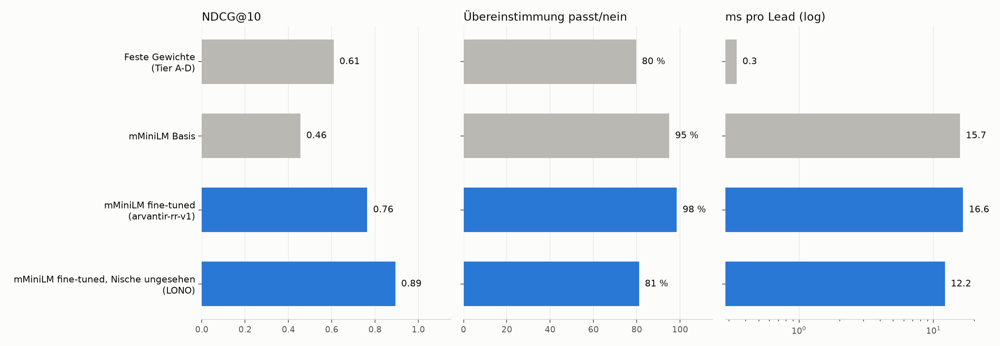

# Re-Ranker-Benchmark (31.10.2026 15:34)

Testmenge: **gold**, 330 Paare, Labels von gold.

| System | NDCG@10 | MRR | Kendall tau | Übereinstimmung passt/nein | needs a human (95 % Präz.) | ms pro Lead | Kosten / 1.000 Leads | Paare |
|---|---|---|---|---|---|---|---|---|
| Feste Gewichte (Tier A-D) | 0.608 | 0.250 | 0.505 | 80 % | 0 % | 0.3 | 0.00 $ | 330 |
| mMiniLM Basis | 0.456 | 0.157 | 0.245 | 95 % | 0 % | 15.7 | 0.00 $ | 330 |
| mMiniLM fine-tuned (arvantir-rr-v1) | 0.764 | 0.278 | 0.527 | 98 % | 0 % | 16.6 | 0.00 $ | 330 |
| mMiniLM fine-tuned, Nische ungesehen (LONO) | 0.894 | 1.000 | 0.581 | 81 % | 11 % | 12.2 | 0.00 $ | 70 |

- mMiniLM fine-tuned, Nische ungesehen (LONO): 2 Gruppen, je Nische das Modell ohne diese Nische
- LLM pointwise: nicht gelaufen (kein OPENAI_API_KEY / OPENAI_BASE_URL)

## Je Gruppe (NDCG@10)

| Gruppe | Feste Gewichte (Tier A-D) | mMiniLM Basis | mMiniLM fine-tuned (arvantir-rr-v1) | mMiniLM fine-tuned, Nische ungesehen (LONO) |
|---|---|---|---|---|
| lead:aerzte_apotheken | – | – | – | – |
| lead:baeckereien_metzgereien | – | – | – | – |
| lead:family_offices | – | – | – | – |
| lead:immobilien_asset_manager | 0.993 | 0.883 | 1.000 | 0.988 |
| lead:it_dienstleister | 0.318 | 0.018 | 0.898 | – |
| lead:maschinenbau | – | – | – | – |
| lead:steuerberater | – | – | – | – |
| lead:waschanlagen | 0.514 | 0.466 | 0.393 | 0.799 |
| source:baeckereien_metzgereien | – | – | – | – |

## Provenance and limits (Malek/Claude, 15:44)
- Test set: 330 gold pairs from `bench/gold_adjudication.json`: 46 agreed by Malek + Claude (blind), 34 set to "nein" by rule (not a company), 250 labeled by Claude alone; 70 disputed pairs excluded.
- Ranking metrics (NDCG/MRR/tau) only exist for niches with positives in gold: real-estate asset managers (6 passt), IT service providers (3 passt, 4 vielleicht), car washes (4 passt, 19 vielleicht). Small numbers, so expect high variance.
- `arvantir-rr-v1` was trained on labels from `finetune/clean.py` (573 changes, including `osm_only`); the LONO models are still on the 519-rule labels.
- Before/after the map-record cap: `bench/results_clean519.md` (NDCG@10 overall 0.667 -> 0.764, IT 0.804 -> 0.898, car washes 0.196 -> 0.393).
- Open: car washes are still below fixed weights (0.514); the model that never saw car washes (LONO) reaches 0.799. So the car-wash training labels are still not good enough.
