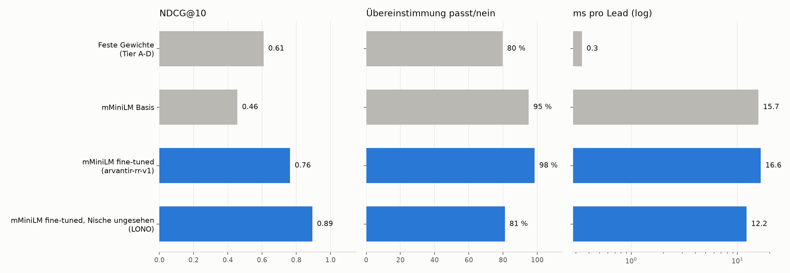

# Re-Ranker-Benchmark (31.10.2026 15:21)

Testmenge: **gold**, 330 Paare, Labels von gold.

| System | NDCG@10 | MRR | Kendall tau | Übereinstimmung passt/nein | needs a human (95 % Präz.) | ms pro Lead | Kosten / 1.000 Leads | Paare |
|---|---|---|---|---|---|---|---|---|
| Feste Gewichte (Tier A-D) | 0.608 | 0.250 | 0.505 | 80 % | 0 % | 0.3 | 0.00 $ | 330 |
| mMiniLM Basis | 0.456 | 0.157 | 0.245 | 95 % | 0 % | 14.3 | 0.00 $ | 330 |
| mMiniLM fine-tuned (arvantir-rr-v1) | 0.667 | 0.230 | 0.497 | 94 % | 0 % | 16.2 | 0.00 $ | 330 |
| mMiniLM fine-tuned, Nische ungesehen (LONO) | 0.894 | 1.000 | 0.581 | 81 % | 11 % | 12.2 | 0.00 $ | 70 |

- mMiniLM fine-tuned, Nische ungesehen (LONO): 2 Gruppen, je Nische das Modell ohne diese Nische
- LLM pointwise: nicht gelaufen (kein OPENAI_API_KEY / OPENAI_BASE_URL)

## Je Gruppe (NDCG@10)

| Gruppe | Feste Gewichte (Tier A-D) | mMiniLM Basis | mMiniLM fine-tuned (arvantir-rr-v1) | mMiniLM fine-tuned, Nische ungesehen (LONO) |
|---|---|---|---|---|
| lead:aerzte_apotheken | – | – | – | – |
| lead:baeckereien_metzgereien | – | – | – | – |
| lead:family_offices | – | – | – | – |
| lead:immobilien_asset_manager | 0.993 | 0.883 | 1.000 | 0.988 |
| lead:it_dienstleister | 0.318 | 0.018 | 0.804 | – |
| lead:maschinenbau | – | – | – | – |
| lead:steuerberater | – | – | – | – |
| lead:waschanlagen | 0.514 | 0.466 | 0.196 | 0.799 |
| source:baeckereien_metzgereien | – | – | – | – |

