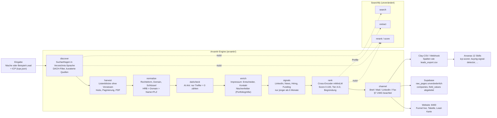
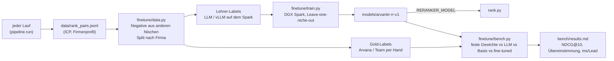

# Arvantir: Architektur

Arvantir ist Searchify, zugeschnitten auf Arvana. Searchify (`searchify-l`: search, extract, rerank) bleibt unverändert. Arvantir ist die GTM-Schicht darüber: Es findet aus öffentlichen Quellen den Dark TAM, also Firmen, die keine Lead-Datenbank kennt, und liefert sie im Format von Arvanas eigenen Skills.

Arvanas 12 claude-gtm-skills fangen alle bei einer fertigen Liste an (`research/ARVANA_WORKFLOW.md`). Arvantir ist der Skill davor.

## Gesamtbild



## Lernschleife: Re-Ranker auf Arvana trainieren



## Module und Zuständigkeit

| Modul | Was | Datei |
|---|---|---|
| discover | Nische -> Quellen, Re-Ranker sortiert Listen nach oben | `arvantir/discover.py` |
| harvest | Quelle -> Firmen, ohne Vorwissen über die Seite, SSRF-geschützt | `arvantir/harvest.py` |
| normalize, darkcheck, enrich, channel | Bereinigen, AI-Ark-Abgleich, Impressum, Kanal | Malek (`arvantir/…`) |
| signals | frische Kaufsignale je Lead | `arvantir/signals.py` |
| rank | Cross-Encoder, Tier A-D nach Arvanas icp-scorer, Konfidenz, Datenlücken | `arvantir/rank.py` |
| pipeline | alles verbinden, Funnel-Zahlen, JSON + CSV | `arvantir/pipeline.py` |
| Skill | `dark-tam-finder` im Stil von claude-gtm-skills | `skills/arvantir/` |
| Adapter | Clay, Supabase | `adapters/` |
| Website | Live-Demo, SSE-Funnel | `web/` |
| Fine-Tuning | Daten, Labels, Training, Benchmark | `finetune/`, `bench/` |

## Datenmodell (für Arvanas CTO)

- **System of Record:** `raw_pages` speichert jede abgerufene Seite unverändert, nur INSERT.
- **Abgeleitet:** `companies`, `people`, `field_values` sind jederzeit aus `raw_pages` neu baubar (`rebuild_derived()`).
- **Provenienz:** jedes Feld hat `source_url`, `method`, `confidence`, `ts`.
- **Schlüssel:** `reg:Gericht|HRB` > `dom:domain` > `name|PLZ`, gleich in Clay und Supabase.

## Sicherheit

- Abrufe fremder Seiten nur über `harvest.fetch`: http(s), öffentliche IPs, jede Weiterleitung geprüft
- CSV-Zellen gegen Formel-Injection escapt
- Website bindet nur an 127.0.0.1, Host-Prüfung gegen DNS-Rebinding, HTML escapt
- Keys nur in `.env`, Trainingsdaten im Repo ohne E-Mails und Telefonnummern

## Starten

```bash
uv pip install -p .venv/bin/python -r requirements.txt
.venv/bin/python -m arvantir run "Waschanlagen"                 # ganzer Lauf, JSON + CSV in data/
.venv/bin/uvicorn web.server:app --host 127.0.0.1 --port 8400   # Website
.venv/bin/python -m pytest tests -q                             # Tests
```
